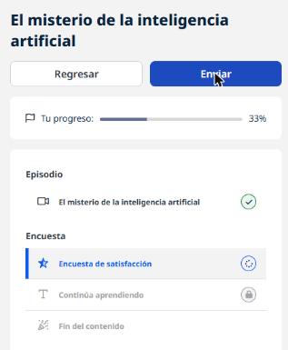

# 02 · El misterio de la inteligencia artificial

**Tipo:** Podcast (Dementes · *El futuro de todo*, T2 E1) · **Duración:** 28 min · **Estado:** En curso (episodio escuchado completo)

Primer episodio de una serie de cinco sobre el presente y futuro de la IA. Su objetivo es construir un **vocabulario común** para hablar de IA sin miedos ni fantasías, con la voz de investigadores, una filósofa científica de datos, un especialista de Google y un doctor en IA del MIT.

## El gancho: la foto falsa del Papa

El episodio arranca con la imagen viral del papa Francisco con una chaqueta de moda de lujo. Era falsa: la creó una persona común con una herramienta de generación de imágenes. Fue uno de los primeros casos masivos de **desinformación hecha con IA** y abrió la pregunta de hasta dónde llega esta tecnología. Le siguieron otras imágenes falsas de políticos, deepfakes de famosos y la carta de expertos que pidió una pausa de seis meses en el desarrollo de los grandes modelos.

## Glosario básico

| Concepto | Mi explicación |
|----------|----------------|
| **Inteligencia artificial** | Término paraguas: usar tecnología digital para reproducir procesos que consideramos inteligentes. Agrupa muchas técnicas, casi todas algoritmos que mejoran con el entrenamiento. |
| **Algoritmo** | Las instrucciones básicas que se le dan a una computadora, escritas en código (ej. "recorre esta lista y suma uno por cada elemento"). |
| **Iteración** | Cada ronda de mejora: se cambian datos, algoritmo o infraestructura y se vuelve a entrenar. Como un nadador que mejora con cada práctica. Ej.: ajustar un recomendador de películas que falla. |
| **IA general (AGI)** | Una IA capaz de dominar varias habilidades cognitivas a la vez, de forma **multimodal** (texto, imagen, audio juntos). Todavía es una meta. |
| **Redes neuronales** | Sistemas inspirados en el cerebro: nodos organizados en capas que reciben, procesan y pasan información, encontrando relaciones que una persona no ve. |
| **Opacidad algorítmica** | No poder explicar cómo una red llegó a un resultado. *Débil*: no lo entendemos por falta de conocimiento, acceso o documentación. *Fuerte*: el proceso es imposible de rastrear incluso para sus creadores. |
| **Lenguaje natural vs. de máquina** | El humano es ambiguo y emocional; el de la máquina es preciso. Un chatbot como ChatGPT actúa como **traductor** entre ambos usando modelos matemáticos. |
| **Alucinación** | Cuando la IA "inventa" algo que no está en sus datos (hechos que no ocurrieron) pero lo presenta con naturalidad. |

## La IA ya está en el día a día

Reconocimiento facial en apps bancarias, recomendaciones en redes, música y video, detección de fraude en tarjetas, filtros de spam, mapas y apps de transporte.

## Cuidado con las metáforas

Decimos que la IA "piensa" o "aprende", pero en realidad **procesa datos** y ajusta su modelo. Usar lenguaje humano para describirla genera más miedo y confusión que claridad. Comparación útil: los aviones no vuelan como las aves, pero vuelan; lo que importa es que el sistema cumpla su función. ChatGPT, por ejemplo, predice la respuesta más probable a partir de patrones en enormes cantidades de texto: es matemática, no conciencia.

!!! tip "Para recordar"
    - IA = término paraguas; algoritmo = instrucciones; iteración = ronda de mejora.
    - AGI = varias habilidades cognitivas + multimodalidad (aún no existe).
    - Opacidad débil (no sé/no tengo acceso) vs. fuerte (nadie puede rastrearlo).
    - ChatGPT traduce entre lenguaje humano y matemático; predice lo más probable.
    - Alucinación = respuesta inventada que suena convincente → siempre verificar.
    - Mejor decir "procesa información" que "piensa".
