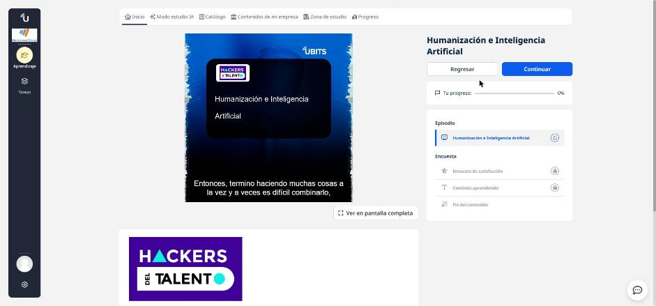
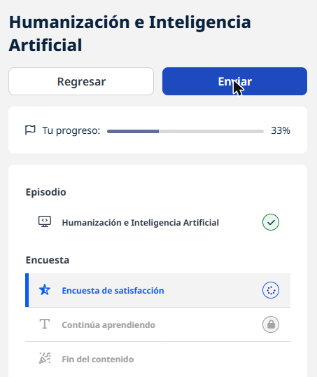

# 03 · Humanización e inteligencia artificial

**Tipo:** Podcast (Hackers del Talento) · **Duración:** 47 min · **Estado:** En curso (episodio escuchado completo)

Entrevista con **Tomás Chamorro-Premuzic**, psicólogo organizacional, director de innovación en ManpowerGroup, profesor universitario y autor de *I, Human*. La pregunta central: **¿cómo seguir siendo humanos en la era de la IA?**, vista desde el talento y las organizaciones.

## Su misión profesional

Convertir la psicología en una herramienta útil en el mundo real: que las personas se entiendan a sí mismas y que las organizaciones entiendan mejor a las personas. Lo hace en tres frentes: aplicando ciencia de datos, evaluaciones e IA al reclutamiento a gran escala; asesorando startups; e invirtiendo en innovación sobre comportamiento humano.

## Lecciones de su historia

- **Aceptar los límites del propio talento:** descubrir a tiempo que el talento amateur no alcanzaba para la élite (en su caso, el fútbol) le llevó a reorientarse.
- **La frustración como motor:** salió de la universidad entre los mejores de su promoción y aun así recibió rechazos porque no tenía estadística ni experiencia de laboratorio. Hizo un máster, luego un doctorado y se especializó en métodos analíticos.
- **Combinar teoría y práctica:** su ventaja fue trabajar en proyectos reales de empresas y usar esos datos para investigar.
- **Autoengaño:** el optimismo ingenuo anima a arriesgarse, pero también hace perder tiempo persiguiendo metas inalcanzables.

### Freud y el manejo de la frustración (contexto del episodio)

| Mecanismo | Idea |
|-----------|------|
| Sublimación | Canalizar la energía negativa en algo productivo o creativo. |
| Represión | Guardar el malestar; a largo plazo suele volver. |
| Análisis | Entender qué hay detrás de la frustración para manejarla mejor. |
| Desplazamiento | Descargar la emoción en algo distinto a su origen. |

## IA, poder y América Latina

- El problema no es solo la tecnología, sino el **modelo de negocio**: la falta de regulación favorece monopolios, y el poder de la IA se concentra en EE. UU. (grandes tecnológicas) y China (Estado).
- No espera que la IA cierre la brecha entre países ricos y la región; lo relevante es **cómo cambia la vida diaria** de las personas.
- El talento latino destaca individualmente (resiliencia, inteligencia emocional) pero le cuesta **organizarse colectivamente**.
- Paradoja: hay que adoptar la tecnología, pero sin perder lo que da calidad de vida (encuentros presenciales, creatividad, improvisación).

## Humanos que se automatizan

Mientras temíamos que las máquinas imitaran a las personas, **las personas nos volvimos más predecibles**, delegando decisiones a los algoritmos de recomendación. Dato del libro: unas 5 horas diarias en el celular equivalen a unos 21 años de vida mirando la pantalla.

## Qué hacer: colaborar, no competir

- La oportunidad no es demostrar en qué somos mejores que la IA, sino **usarla para ampliar nuestras capacidades**.
- En recursos humanos, la IA permite decisiones más **empíricas y meritocráticas**, reduciendo nepotismo y sesgos, siempre con una **filosofía humanista**.
- Retos: aprendizaje continuo, actualización de habilidades y equilibrio entre lo humano y lo automatizado.
- Ética: sesgo algorítmico, privacidad de datos y decisiones autónomas exigen regulación, supervisión y responsabilidad.

## Habilidades humanas clave

**Empatía**, **vulnerabilidad** (compartir la propia historia para crear relaciones auténticas), **curiosidad**, hacer **preguntas poderosas** y **aprender rápido**. Un consejo que destaca: no todo se trata de uno mismo; tomar perspectiva reduce conflictos.

!!! tip "Para recordar"
    - Trabajar **con** la IA, no **contra** ella: usarla para hacer mejores preguntas.
    - En talento humano, la IA puede volver las decisiones más justas y basadas en datos.
    - El riesgo no es solo que la máquina se parezca a nosotros, sino que nosotros nos volvamos máquinas.
    - Empatía, vulnerabilidad y aprendizaje acelerado son la ventaja humana.
    - Adoptar la tecnología sin sacrificar la calidad de vida.
