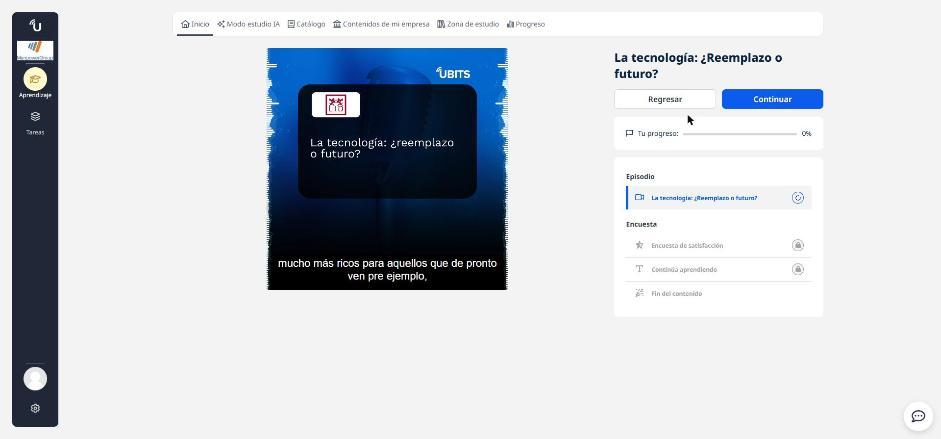
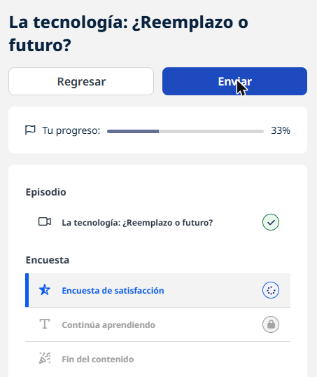

# 04 · La tecnología: ¿reemplazo o futuro?

**Tipo:** Podcast (LID Podcast) · **Duración:** 12 min · **Estado:** En curso (episodio escuchado completo)

Conversación con **Hermes Ruiz**, conferencista en IA, metaverso y futuro del trabajo, y autor de *Lo que callan los amantes del mañana*. Idea central: la tecnología no es una amenaza en sí misma, sino un **aliado estratégico** cuando se pone al servicio de las personas.

## La tecnología es "carpintería"

Para Hermes, la tecnología es la parte menos importante del ejercicio. Primero hay que tener claro el **por qué, el qué y el cómo**, y poner a las personas en el centro. La tecnología llega después, como **catalizador** que facilita procesos, mejora la calidad de vida y, en las empresas, aumenta productividad, rentabilidad y sostenibilidad.

## ¿Nos va a reemplazar?

- Cada revolución tecnológica despertó el mismo miedo. Ejemplo: la llegada del automóvil frente a los cocheros; con el tiempo la producción creció y los empleos se multiplicaron en nuevas áreas.
- La IA (incluidos los modelos tipo GPT) no viene a eliminarnos: **quien puede desplazarte es otra persona que sepa usar bien la IA**.
- El temor suele venir de no saber usar la herramienta, no de la herramienta.

## Cómo prepararse (enfoque para organizaciones)

1. **Las personas primero.** No es romanticismo, es estrategia: trabajadores de oficina o de campo deben entender cómo la tecnología les ayuda.
2. **Habilidades del siglo XXI:** identificar fuentes confiables, procesar y sintetizar grandes volúmenes de información ("separar la paja del trigo"), innovar y comunicar bien.
3. **Diseñar la experiencia.** Toda decisión tecnológica impacta la experiencia del colaborador, del cliente, del ciudadano y de la organización.
4. **Priorizar con criterio.** Evaluar inversión frente a impacto en cada una de esas experiencias antes de elegir proyectos; no invertir solo porque algo está de moda.

## Trabajo remoto y aislamiento

El trabajo remoto es parte de la realidad actual. La tecnología por sí misma no aísla: si se elige pensando en potenciar a la gente, no debería generar choque ni aislamiento. La pandemia lo demostró: las empresas sobrevivieron porque usaron la tecnología para sostener la **experiencia**, no por la tecnología en sí.

## Ya usamos IA sin notarlo

Muchas personas dicen no usar IA, pero usan plataformas de streaming, apps de navegación y recomendadores todos los días. El mito y el miedo están más en el discurso corporativo que en la práctica cotidiana.

!!! tip "Para recordar"
    - Tecnología = carpintería: primero el propósito y las personas, después la herramienta.
    - La IA no reemplaza; reemplaza quien la usa mejor → aprender a usarla.
    - Habilidades clave: filtrar fuentes, sintetizar datos, innovar y comunicar.
    - Medir cada proyecto por su impacto en la experiencia (colaborador, cliente, ciudadano, organización).
    - Abrazar la tecnología con curiosidad, no con miedo.

## Fuentes y aviso legal

- **Fuente:** curso de UBITS. Sitios oficiales: [ubits.com](https://ubits.com).
- **Uso:** apuntes personales de estudio, sin fines comerciales y con redacción propia. Las imágenes del curso son fragmentos breves citados con fines educativos; sus derechos son de sus titulares.
- **Sin afiliación:** sitio no oficial, no afiliado ni respaldado por UBITS. Las marcas pertenecen a sus dueños.
- Más detalles y cómo pedir el retiro de contenido en el [aviso legal](../../aviso-legal.md).
