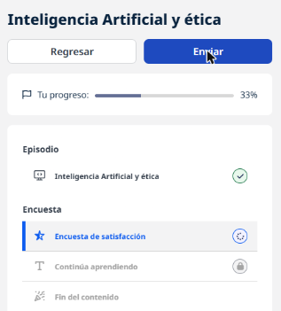

# 06 · Inteligencia artificial y ética

**Tipo:** Podcast (Hackers del Talento) · **Duración:** 53 min · **Estado:** En curso (episodio escuchado completo)

Entrevista con **Paolo Benanti**, fraile franciscano, ingeniero de formación, teólogo y profesor de ética de la tecnología, asesor del Vaticano en IA. Su tesis central: **la tecnología no es neutral**; cada artefacto tecnológico ordena la sociedad y distribuye poder.

## La IA en una encrucijada

La IA ofrece oportunidades enormes (salud, sostenibilidad), pero si las decisiones importantes se delegan a sistemas sin mirada ética, se corre el riesgo de manipular emociones y decisiones de las personas.

## La tecnología es una forma de poder

Ejemplo clásico que usa Benanti: unos puentes en Nueva York se construyeron más bajos de lo normal, de modo que los autobuses no podían pasar. Así, solo quienes tenían auto (en esa época, una clase social concreta) podían llegar a ciertas playas. **El concreto también hace política.**

La IA funciona igual: los algoritmos que corren en la nube moldean lo que vemos, opinamos y decidimos. La pregunta ética es **cómo hacer ese poder visible y compatible con la democracia**, porque puede llegar a ser más fuerte que el poder público.

## Preguntas que plantea

- ¿Qué significa delegar una decisión humana en un algoritmo que **no siempre es explicable**?
- Si los modelos de lenguaje pueden impactar una parte importante de los empleos y muestran cierta "agencia", ¿podemos dejar que decidan por nosotros si no los controlamos del todo?
- ¿Cómo formarnos para interactuar con una IA tan potente **sin dejarnos engañar** por sus alucinaciones?

La IA debe ser una **herramienta de apoyo a la decisión**, siempre con una persona que evalúe el resultado, transparencia y protección de los derechos humanos.

## Retos para América Latina

| Riesgo | Idea |
|--------|------|
| **Colonialismo cognitivo** | Usar trabajo intelectual mal pagado de la región para entrenar IA de otros: ya no se extrae oro o azúcar, sino capacidad cognitiva. |
| **Poder blando algorítmico** | Algoritmos de redes sociales, diseñados para marketing, que polarizan la opinión pública y nunca "se cansan". |
| **Empleo** | La IA puede afectar primero a los trabajos cognitivos mejor pagados. |
| **Dependencia** | Solo dos grandes productores de IA (EE. UU. y China); una región dividida negocia peor. |

## ¿Basta con la ética?

No. La ética es **ley blanda**: una voz que llega profundo pero que se puede ignorar. Hace falta también **regulación** y acuerdos, especialmente en un contexto geopolítico tenso.

## Automatizar vs. innovar

- **Automatizar** = copiar el proceso actual en digital.
- **Innovar** = **rediseñar el proceso** combinando IA y personas para hacerlo más rápido, confiable y flexible.
- Ejemplo: en vez de un robot carísimo que plancha como una persona, una máquina que plancha y dobla como una impresora, con la persona alimentándola.
- Dos modelos de empresa: usar la tecnología para **potenciar a las personas** (*human in the loop*) o para **reemplazarlas**. Si la IA "se come" el conocimiento interno, la empresa queda dependiendo de su proveedor.

## Funcionar vs. existir

Una máquina **funciona**; una persona **existe**. Un secador de pelo se apaga y se vuelve a encender; un ser vivo no. La diferencia es de **calidad, no de cantidad**: felicidad, sentido de vida y bienestar no se miden en eficiencia. Las personas merecen derechos humanos; a la máquina hay que darle su lugar correcto.

## Cierre

Apostar por la **naturaleza humana** y por la **educación** (formal e informal) para cooperar con la máquina en lugar de competir con ella. Consejo personal: nada de lo vivido se desperdicia; ante un desafío sin respuesta, calma.

!!! tip "Para recordar"
    - La tecnología no es neutral: es una forma de poder y de orden.
    - IA = apoyo a la decisión, con humano en el circuito y transparencia.
    - Ética sola no alcanza: hace falta regulación.
    - Innovar es rediseñar el proceso, no solo automatizarlo.
    - Riesgos para la región: colonialismo cognitivo, polarización, dependencia.
    - Funcionar no es existir: el sentido de la vida no se mide en eficiencia.
