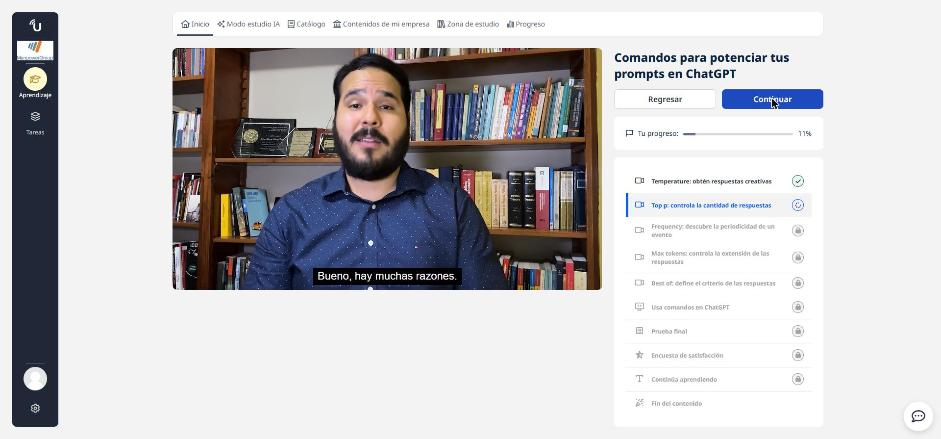
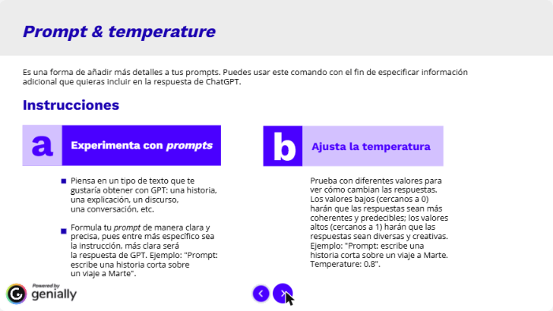
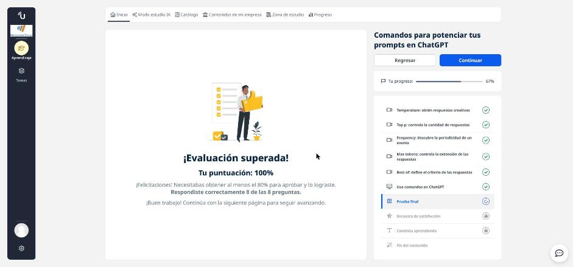
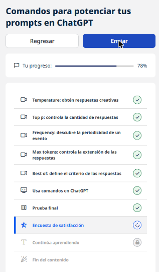

# 07 · Comandos para potenciar tus prompts en ChatGPT

**Tipo:** Curso (UBITS) · **Duración:** 43 min · **Estado:** En curso (lecciones y prueba final completadas) · **Prueba final:** 100 % (8/8)

Curso corto en video sobre cómo **acotar y orientar** las respuestas de ChatGPT agregando "comandos" al final del prompt. Cada lección presenta un comando, para qué sirve y un ejemplo; al final hay una actividad interactiva y una prueba.



## El punto de partida: el prompt

El **prompt** es la instrucción o pregunta que le das al modelo. Mientras más claro y específico, mejor la respuesta. Un buen patrón es asignar un rol y un objetivo: "actúa como experto en X; necesito que me expliques Y para Z".

## Los comandos

| Comando | Para qué sirve | Cómo lo entiendo |
|---------|----------------|------------------|
| **Temperature** | Ajusta la creatividad, con un valor de 0 a 1. | Cerca de 0 → respuestas predecibles y coherentes. Cerca de 1 (ej. 0.8) → respuestas más variadas y originales. Es un "termómetro de creatividad". |
| **Top p** | Pide varias respuestas o alternativas. | Funciona como un menú de opciones para explorar distintos enfoques. Junto con Temperature, controla la variedad de las respuestas. |
| **Frequency** | Pregunta con qué frecuencia ocurre algo. | Útil para saber cada cuánto se repite un evento o cuántas veces aparece un término. |
| **Max tokens** | Limita la extensión de la respuesta. | Un token equivale aproximadamente a una palabra. Sirve para resúmenes, pitches cortos y publicaciones en redes. |
| **Best of** | Pide que se elija la mejor respuesta según un criterio. | Tú defines el criterio (relevancia, originalidad, profundidad, coherencia…) y el modelo filtra según él. |



## Ejemplos de comandos (mis propias versiones)

```text
Prompt: actúa como analista de datos y explícame qué es una tabla dinámica para alguien que nunca usó Excel.
Temperature: 0.2
```

```text
Prompt: dame ideas para presentar un informe trimestral de forma original.
Temperature: 0.8
```

```text
Prompt: propón formas de usar IA en un equipo de reclutamiento.
Top p: 4
```

```text
Frequency: Juegos Olímpicos de verano
```

```text
Prompt: resume qué es el aprendizaje supervisado.
Max tokens: 40
```

```text
Prompt: recomiéndame un curso introductorio de ciencia de datos.
Best of: relevancia para principiantes
```

## Buenas prácticas

- Primero un **prompt claro** (rol + tarea + contexto); los comandos son un ajuste fino.
- Usar **Temperature baja** para datos, definiciones o código, y **alta** para lluvias de ideas.
- Combinar comandos: por ejemplo Top p + Temperature para explorar alternativas con más o menos creatividad.
- Experimentar: cambiar un valor a la vez y comparar resultados.
- Estas indicaciones escritas en el chat **orientan** al modelo; en la API, *temperature*, *top_p* y *max_tokens* son parámetros técnicos reales.

## Resultado

Prueba final superada con **100 % (8 de 8)**; el mínimo para aprobar era 80 %.





!!! tip "Para recordar"
    - **Prompt** = la instrucción; todo lo demás la ajusta.
    - **Temperature** 0 → preciso / 1 → creativo.
    - **Top p** → varias respuestas · **Frequency** → cada cuánto pasa algo.
    - **Max tokens** → longitud máxima · **Best of** → la mejor según tu criterio.
    - Pista: una respuesta corta es **Max tokens**; elegir según un criterio es **Best of**; más creatividad es una **temperatura alta**.

## Fuentes y aviso legal

- **Fuente:** curso de UBITS. Sitios oficiales: [ubits.com](https://ubits.com).
- **Uso:** apuntes personales de estudio, sin fines comerciales y con redacción propia. Las imágenes del curso son fragmentos breves citados con fines educativos; sus derechos son de sus titulares.
- **Sin afiliación:** sitio no oficial, no afiliado ni respaldado por UBITS. Las marcas pertenecen a sus dueños.
- Más detalles y cómo pedir el retiro de contenido en el [aviso legal](../../aviso-legal.md).
