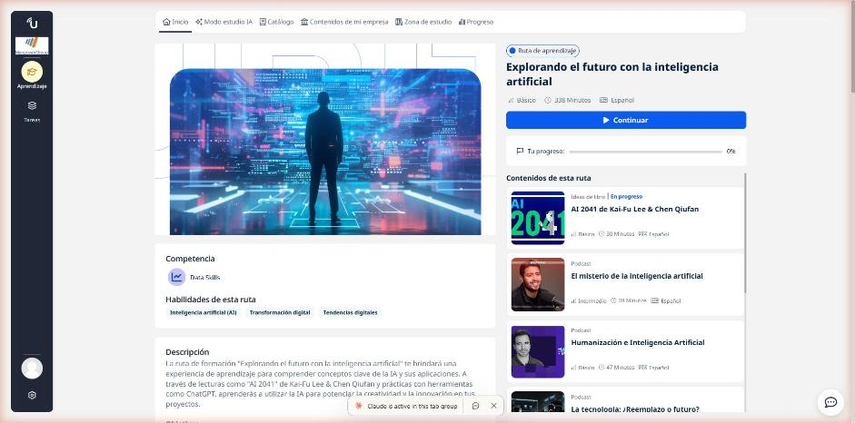
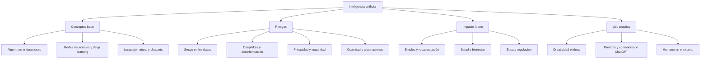

# UBITS · Explorando el futuro con la inteligencia artificial

Ruta de aprendizaje de UBITS (nivel básico, ~338 min) para entender los conceptos clave de la IA, sus riesgos y oportunidades, y usar herramientas como ChatGPT para potenciar la creatividad y la innovación.

## Contenidos

| # | Contenido | Tipo | Estado | Resultado | Notas |
|---|-----------|------|--------|-----------|-------|
| 1 | AI 2041 de Kai-Fu Lee & Chen Qiufan | Ideas de libro | Completado | 100 % | [01 · AI 2041](01-ai-2041.md) |
| 2 | El misterio de la inteligencia artificial | Podcast | En curso | Episodio completo (33 %) | [02 · Misterio IA](02-misterio-ia.md) |
| 3 | Humanización e Inteligencia Artificial | Podcast | En curso | Episodio completo (33 %) | [03 · Humanización](03-humanizacion-ia.md) |
| 4 | La tecnología: ¿Reemplazo o futuro? | Podcast | En curso | Episodio completo (33 %) | [04 · Reemplazo o futuro](04-tecnologia-reemplazo-futuro.md) |
| 5 | Creatividad e inteligencia artificial | Podcast | En curso | Episodio completo (33 %) | [05 · Creatividad](05-creatividad-ia.md) |
| 6 | Inteligencia Artificial y ética | Podcast | En curso | Episodio completo (33 %) | [06 · IA y ética](06-ia-etica.md) |
| 7 | Comandos para potenciar tus prompts en ChatGPT | Curso | En curso | Prueba final 100 % (8/8) · 78 % | [07 · Comandos ChatGPT](07-comandos-prompts-chatgpt.md) |

**Progreso:** 1 de 7 completados (14 %) · 6 en curso (contenidos vistos, falta cerrar cada ítem).

## Mapa de conceptos

## Fuentes y aviso legal

- **Fuente:** curso de UBITS. Sitios oficiales: [ubits.com](https://ubits.com).
- **Uso:** apuntes personales de estudio, sin fines comerciales y con redacción propia. Las imágenes del curso son fragmentos breves citados con fines educativos; sus derechos son de sus titulares.
- **Sin afiliación:** sitio no oficial, no afiliado ni respaldado por UBITS. Las marcas pertenecen a sus dueños.
- Más detalles y cómo pedir el retiro de contenido en el [aviso legal](../../aviso-legal.md).
