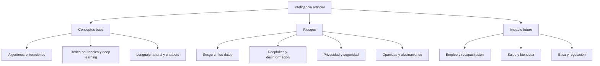

# UBITS · Explorando el futuro con la inteligencia artificial

Ruta de aprendizaje de UBITS (nivel básico, ~338 min) para entender los conceptos clave de la IA, sus riesgos y oportunidades, y usar herramientas como ChatGPT para potenciar la creatividad y la innovación.

## Contenidos

| # | Contenido | Tipo | Estado | Resultado | Notas |
|---|-----------|------|--------|-----------|-------|
| 1 | AI 2041 de Kai-Fu Lee & Chen Qiufan | Ideas de libro | Completado | 100 % | [01 · AI 2041](01-ai-2041.md) |
| 2 | El misterio de la inteligencia artificial | Podcast | En curso | Episodio completo (33 %) | [02 · Misterio IA](02-misterio-ia.md) |
| 3 | Humanización e Inteligencia Artificial | Podcast | Pendiente | — | — |
| 4 | La tecnología: ¿Reemplazo o futuro? | Podcast | Pendiente | — | — |
| 5 | Creatividad e inteligencia artificial | Podcast | Pendiente | — | — |
| 6 | Inteligencia Artificial y ética | Podcast | Pendiente | — | — |
| 7 | Comandos para potenciar tus prompts en ChatGPT | Curso | Pendiente | — | — |

**Progreso:** 1 de 7 completados (14 %) · 1 en curso.

## Mapa de conceptos

