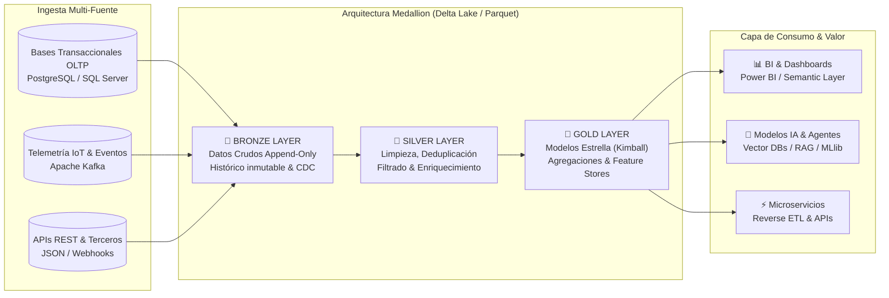

# Arquitectura de Datos & Fundamentos de Data Engineering

> "Transformando datos dispersos en activos estratégicos de alta confiabilidad, baja latencia y estricto gobierno."

---

## 🏛️ El Paradigma Moderno de Ingeniería de Datos

La ingeniería de datos contemporánea trasciende los simples scripts de extracción y carga (ETL). En la actualidad, constituye una disciplina de **ingeniería de software distribuida** encargada de garantizar los pilares de **Confiabilidad (Reliability)**, **Escalabilidad (Scalability)** y **Mantenibilidad (Maintainability)** sobre flujos masivos de información estructurada, semiestructurada y no estructurada.



---

## 📖 Libros & Referencias Fundamentales

### 1. *Designing Data-Intensive Applications* — Martin Kleppmann
*El estándar definitivo sobre los cimientos de los sistemas distribuidos de datos.*

!!! quote "Notas Críticas & Principios Arquitecturales"
    - **Confiabilidad ante Fallos:** Un sistema confiable anticipa fallos de hardware, software y errores humanos. Se prioriza el principio de inmutabilidad en la ingesta para permitir reprocesamiento determinista ante bugs en la lógica de negocio.
    - **Evolución de Motores de Almacenamiento:**
        - **LSM-Trees (Log-Structured Merge-Trees) & SSTables:** Optimizados para escritura secuencial de alto rendimiento (usados en Cassandra, RocksDB, Kafka).
        - **B-Trees:** Optimizados para lecturas aleatorias indexadas en memoria y disco (usados en PostgreSQL, MySQL).
        - **Almacenamiento Columnar (Parquet, ORC):** Almacenamiento contiguo por columnas con codificación por diccionario y *Run-Length Encoding (RLE)*, reduciendo drásticamente la transferencia de I/O en queries analíticas (OLAP).
    - **Modelos de Replicación & Consenso:** Replicación Single-Leader vs Multi-Leader vs Leaderless (Quorum $W + R > N$). Comprensión profunda del teorema CAP y consistencia eventual (*Monotonic Reads*, *Read-Your-Own-Writes*).

---

### 2. *Fundamentals of Data Engineering* — Joe Reis & Matt Housley
*El marco contemporáneo del ciclo de vida y las corrientes transversales de ingeniería.*

!!! quote "El Ciclo de Vida de los Datos & Subcorrientes (Undercurrents)"
    1. **Generación (Source Systems):** Diseñar contratos de datos (*Data Contracts*) con los equipos de software origen para prevenir cambios de esquema no advertidos.
    2. **Almacenamiento:** Separación desacoplada de cómputo y almacenamiento (Object Storage S3/ADLS Gen2 + motores distribuidos).
    3. **Ingesta:** Selección consciente entre Batch, Micro-batch y Event-Driven Streaming según el *SLA de frescura* requerido por el negocio.
    4. **Transformación:** Adopción del paradigma ELT declarativo donde los datos se transforman dentro del motor analítico usando SQL modular y versionado.
    5. **Servicio:** Democratización de datos gobernada mediante catálogos centralizados (Unity Catalog, Microsoft Purview).
    - **Corrientes Transversales:** Seguridad perimetral y cifrado (AES-256 en reposo, TLS 1.3 en tránsito), DataOps (CI/CD con validación de tests automatizados) y FinOps (monitoreo proactivo de costos de cómputo en la nube).

---

## 🏗️ El Patrón Arquitectónico Medallion en Producción

| Capa | Propósito Operativo | Formato & Calidad | Estrategia de Carga |
| :--- | :--- | :--- | :--- |
| **🥉 Bronze (Raw / Crudo)** | Preservar la fuente de verdad histórica sin pérdidas. Ingesta cruda append-only con metadatos de auditoría (`ingestion_timestamp`, `source_file`). | Delta Lake / Parquet comprimido con Snappy / ZSTD. Esquema flexible o rescate de columnas corruptas (`_rescued_data`). | Append-only continuo o por lotes de alta frecuencia. |
| **🥈 Silver (Cleansed / Conforme)** | Limpieza, estandarización de tipos, deduplicación de llaves de negocio, validación de reglas de calidad y enriquecimiento con tablas maestras. | Delta Lake con esquema estricto y restricciones de tabla (`CHECK constraints`). Tablas de dimensiones limpias. | Upsert / Merge basado en llaves primarias de negocio. |
| **🥇 Gold (Curated / Consumo)** | Modelado dimensional optimizado para consumo analítico de alto rendimiento: esquemas estrella (Fact & Dimension Tables), agregaciones precalculadas y vistas materializadas. | Delta Lake optimizado con Liquid Clustering o Z-Order. Tablas dimensionales listas para Power BI y analítica ejecutiva. | Sobrescritura particionada o actualización incremental. |

---

## 🧪 Pipeline de Producción en Apache Airflow (DAG Moderno)

Este pipeline implementa el patrón **TaskFlow API** de Apache Airflow 2.x con manejo de reintentos exponenciales, validación de contratos de calidad y trazabilidad de linaje:

```python
"""
Pipeline ETL Medallion Orquestado con TaskFlow API
Autor: Erick Sang (Leonsang)
Propósito: Extracción transaccional, tipado conforme y carga en Gold Layer.
"""
from datetime import datetime, timedelta
from airflow.decorators import dag, task
import logging

logger = logging.getLogger(__name__)

default_args = {
    'owner': 'ericksang',
    'depends_on_past': False,
    'email_on_failure': True,
    'email': ['ericksang@gmail.com'],
    'retries': 3,
    'retry_delay': timedelta(minutes=2),
    'retry_exponential_backoff': True,
}

@dag(
    dag_id='lakehouse_medallion_pipeline_v2',
    default_args=default_args,
    description='Pipeline empresarial con validación de calidad y promoción Bronze -> Silver -> Gold',
    schedule_interval='@daily',
    start_date=datetime(2026, 1, 1),
    catchup=False,
    tags=['production', 'lakehouse', 'delta', 'airflow'],
)
def lakehouse_medallion_pipeline():

    @task(retries=2)
    def ingest_to_bronze() -> dict:
        """Extrae datos de fuentes transaccionales y persiste en Bronze con metadatos."""
        logger.info("Iniciando ingesta incremental hacia Bronze Layer...")
        ingestion_metadata = {
            'records_read': 145000,
            'bronze_path': 'abfss://lakehouse@storagedata.dfs.core.windows.net/bronze/transactions/',
            'batch_id': 'batch_20261030_01',
            'status': 'SUCCESS'
        }
        return ingestion_metadata

    @task
    def validate_and_promote_silver(bronze_info: dict) -> dict:
        """Aplica deduplicación, tipado y reglas de calidad antes de escribir en Silver."""
        logger.info(f"Procesando lote {bronze_info['batch_id']} en Silver Layer...")
        # Simulación de control de calidad: rechazo de nulos en identificadores
        records_processed = bronze_info['records_read'] - 120  # 120 registros corruptos enviados a cuarentena
        silver_metadata = {
            'records_promoted': records_processed,
            'quarantine_records': 120,
            'silver_table': 'silver.fct_transactions_conformed',
            'status': 'SUCCESS'
        }
        return silver_metadata

    @task
    def build_gold_aggregates(silver_info: dict) -> dict:
        """Calcula agregaciones analíticas para consumo ejecutivo en Power BI."""
        logger.info(f"Calculando cubos y métricas en Gold desde {silver_info['silver_table']}...")
        gold_summary = {
            'gold_kpi_table': 'gold.agg_daily_revenue_executive',
            'rows_written': 365,
            'status': 'SUCCESS'
        }
        return gold_summary

    # Definición de dependencias declarativas
    bronze_res = ingest_to_bronze()
    silver_res = validate_and_promote_silver(bronze_res)
    build_gold_aggregates(silver_res)

# Instanciación del DAG
pipeline = lakehouse_medallion_pipeline()
```

---

## 🔗 Navegación & Recursos Directos

Explore los módulos prácticos y laboratorios de ingeniería de datos integrados en este repositorio:

<div style="display: grid; grid-template-columns: repeat(auto-fit, minmax(260px, 1fr)); gap: 14px; margin-top: 1.5rem;">
  <a href="../spark/" class="md-button" style="text-align: left; padding: 14px; display: block;">
    <strong>⚡ Apache Spark & Internals</strong><br>
    <span style="font-size: 0.8rem; opacity: 0.85;">Catalyst Optimizer, Tungsten y 24 notebooks de optimización.</span>
  </a>
  <a href="../kafka/" class="md-button" style="text-align: left; padding: 14px; display: block;">
    <strong>🔥 Apache Kafka Streaming</strong><br>
    <span style="font-size: 0.8rem; opacity: 0.85;">Arquitectura de eventos en tiempo real y Schema Registry.</span>
  </a>
  <a href="../ADF_scenarios/" class="md-button" style="text-align: left; padding: 14px; display: block;">
    <strong>☁️ Azure Data Factory Scenarios</strong><br>
    <span style="font-size: 0.8rem; opacity: 0.85;">11 pipelines de producción con Webhooks, Loggers y Delta.</span>
  </a>
  <a href="../bi/" class="md-button" style="text-align: left; padding: 14px; display: block;">
    <strong>📊 BI, Modelado Estrella & DAX</strong><br>
    <span style="font-size: 0.8rem; opacity: 0.85;">Kimball dimensional modeling, contextos DAX y proyectos PBIP.</span>
  </a>
</div>
