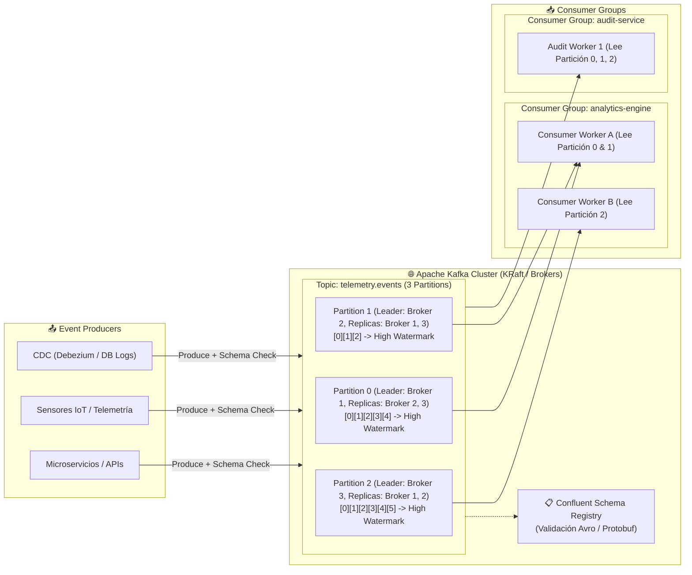

# Apache Kafka: Streaming Distribuido en Tiempo Real

> "Ingesta continua de eventos de alta velocidad, desacoplamiento absoluto de productores y consumidores, y garantías de procesamiento exactamente-una-vez (EOS)."

---

## ⚡ Anatomía de un Clúster de Apache Kafka

Apache Kafka es un registro de confirmación distribuido (**Distributed Commit Log**) optimizado para el procesamiento masivo de flujos de eventos. En lugar de almacenar mensajes en colas transitorias que se eliminan al ser leídas, Kafka persiste los eventos en disco de forma secuencial durante un periodo de retención configurable, permitiendo que múltiples consumidores lean a su propio ritmo.



---

## 📖 Libros & Referencias Fundamentales

### 1. *Kafka: The Definitive Guide (2nd Edition)* — Gwen Shapira, Todd Palino, Rajini Sivaram & Krit Petty
*La referencia definitiva sobre arquitectura interna, fiabilidad y afinamiento en producción.*

!!! quote "Garantías de Entrega & Optimización a Nivel de Sistema Operativo"
    - **Por qué Kafka es Extremadamente Rápido (Zero-Copy & Page Cache):**
        - **Sequential Disk I/O:** Escribir en un archivo de log secuencial en disco es comparable en velocidad a escribir en memoria RAM aleatoria. Kafka evita reestructuraciones en árbol (B-Trees) en disco; únicamente añade al final (*Append-only*).
        - **Zero-Copy Data Transfer (`sendfile()` Syscall):** En lugar de copiar bytes del kernel al espacio de usuario de la JVM y luego de vuelta al socket de red del kernel, Kafka utiliza la llamada al sistema `sendfile()`, transfiriendo datos directamente desde el Page Cache del sistema operativo hacia el socket de red sin tocar la memoria de la JVM.
    - **Fiabilidad en el Productor (Producer Semantics):**
        - `acks=0`: El productor envía y no espera confirmación (mínima latencia, riesgo alto de pérdida).
        - `acks=1`: El productor espera a que el *Partition Leader* escriba en su log local.
        - `acks=all` (o `-1`): El líder espera la confirmación de todas las réplicas en sincronía (*In-Sync Replicas - ISR*). Combinado con `min.insync.replicas=2`, garantiza que ningún evento confirmado se pierda aunque muera el líder.
        - **Productor Idempotente (`enable.idempotence=true`):** El broker asigna a cada productor un ID único (*Producer ID - PID*) y números de secuencia incrementales a cada mensaje. Si un reintento por timeout de red envía un mensaje duplicado, el broker lo descarta automáticamente sin corromper el log.

---

### 2. *Streaming Systems* — Tyler Akidau, Slava Chernyak & Reuven Lax
*El modelo unificado para procesamiento de eventos continuos y temporales.*

!!! quote "Las Cuatro Preguntas del Procesamiento en Streaming"
    - **¿Qué (What) se está calculando?** Definido por las transformaciones (sumas, filtros, conteos).
    - **¿Dónde (Where) en el tiempo del evento se calcula?** Definido por las ventanas temporales:
        - **Tumbling Windows:** Ventanas fijas sin solapamiento (ej. cada 5 minutos exactos).
        - **Sliding / Hopping Windows:** Ventanas móviles con solapamiento (ej. ventana de 1 hora evaluada cada 5 minutos).
        - **Session Windows:** Ventanas dinámicas cerradas por periodos de inactividad del usuario.
    - **¿Cuándo (When) en el tiempo de procesamiento se materializan los resultados?** Definido por los **Watermarks** (marcas de agua) que indican que el sistema asume que ya no llegarán eventos con timestamp anterior a dicha marca.
    - **¿Cómo (How) se relacionan las correcciones?** Acumulación (*Accumulating*), descarte (*Retracting*) o sobrescritura de resultados rezagados (*Late Data*).

---

## 🛠️ Buenas Prácticas & Rebalanceo de Consumidores

| Desafío en Producción | Mecanismo de Kafka | Recomendación Práctica |
| :--- | :--- | :--- |
| **Stop-the-World en Rebalanceos** | *Incremental Cooperative Rebalance* | Activar `CooperativeStickyAssignor` en los consumidores para que solo se transfieran las particiones reasignadas, permitiendo que el resto del grupo continúe procesando sin detener el flujo. |
| **Consumer Lag (Retraso)** | Escalar consumidores horizontalmente | El número máximo de consumidores activos en un mismo Consumer Group está limitado por el número de particiones del topic. Añadir más consumidores que particiones dejará nodos ociosos. |
| **Evolución del Esquema** | *Confluent Schema Registry* | Configurar el modo `BACKWARD` o `FULL` para garantizar que los nuevos campos opcionales no rompan los consumidores antiguos en producción. |

---

## 🧪 Implementación en Python con `confluent-kafka`

### Productor Idempotente con Delivery Callback

```python
"""
Productor Idempotente de Alta Confiabilidad en Apache Kafka
Autor: Erick Sang (Leonsang)
"""
from confluent_kafka import Producer
import json
import logging

logging.basicConfig(level=logging.INFO)
logger = logging.getLogger(__name__)

conf = {
    'bootstrap.servers': 'localhost:9092',
    'client.id': 'payment-producer-v1',
    'acks': 'all',                          # Garantizar escritura en todos los ISR
    'enable.idempotence': True,            # Prevenir duplicados en reintentos
    'compression.type': 'snappy',          # Compresión eficiente de batches
    'linger.ms': 10,                       # Esperar 10ms para empaquetar más mensajes
    'batch.size': 32768                    # Batch de hasta 32 KB
}

producer = Producer(conf)

def delivery_report(err, msg):
    """Callback invocado cuando el broker confirma la persistencia del mensaje."""
    if err is not None:
        logger.error(f"Fallo en entrega de mensaje: {err}")
    else:
        logger.info(f"Evento entregado exitosamente a topic '{msg.topic()}' [partición {msg.partition()}] en offset {msg.offset()}")

# Publicación de evento con llave para garantizar orden particionado
event_payload = {
    'transaction_id': 'tx_998124',
    'customer_id': 'cust_001',
    'amount': 450.75,
    'currency': 'USD',
    'status': 'AUTHORIZED'
}

producer.produce(
    topic='financial.transactions.v1',
    key='cust_001',  # Mensajes con la misma llave van a la misma partición
    value=json.dumps(event_payload).encode('utf-8'),
    callback=delivery_report
)

producer.flush(timeout=10)
```

---

## 🔗 Navegación & Recursos Directos

Explore los contenidos relacionados con arquitecturas orientadas a eventos en este repositorio:

<div style="display: grid; grid-template-columns: repeat(auto-fit, minmax(260px, 1fr)); gap: 14px; margin-top: 1.5rem;">
  <a href="../streaming-architecture/" class="md-button" style="text-align: left; padding: 14px; display: block;">
    <strong>🌊 Streaming Architecture</strong><br>
    <span style="font-size: 0.8rem; opacity: 0.85;">Patrones de integración Kappa y procesamiento de eventos continuos.</span>
  </a>
  <a href="../kafka/README/" class="md-button" style="text-align: left; padding: 14px; display: block;">
    <strong>📚 Kafka Ecosystem Docs</strong><br>
    <span style="font-size: 0.8rem; opacity: 0.85;">Documentación complementaria de Kafka Connect y Schema Registry.</span>
  </a>
  <a href="../spark/" class="md-button" style="text-align: left; padding: 14px; display: block;">
    <strong>⚡ Spark Structured Streaming</strong><br>
    <span style="font-size: 0.8rem; opacity: 0.85;">Consumo micro-batch de Kafka y checkpoints con Delta Lake.</span>
  </a>
  <a href="../humano-conocimiento/" class="md-button md-button--primary" style="text-align: left; padding: 14px; display: block;">
    <strong>🧠 Mapa 3D Neuro-Cognitivo</strong><br>
    <span style="font-size: 0.8rem; opacity: 0.85;">Ver la corteza sensorial y motora en el modelo tridimensional.</span>
  </a>
</div>
