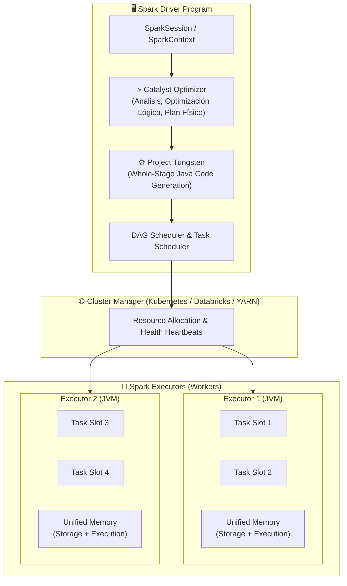

# Apache Spark: Motor de Cómputo Distribuido & Optimización

> "De consultas declarativas en PySpark a código bytecode Java compilado en milisegundos sobre memoria off-heap."

---

## ⚡ Anatomía del Motor de Cómputo Spark

Apache Spark es un motor unificado de análisis para el procesamiento distribuido de datos a gran escala. A diferencia de los motores MapReduce de primera generación que persistían estados intermedios en disco HDFS, Spark opera sobre memoria RAM distribuida utilizando grafos acíclicos dirigidos (**DAGs**) optimizados.



---

## 📖 Libros & Referencias Fundamentales

### 1. *Spark: The Definitive Guide* — Bill Chambers & Matei Zaharia
*La guía autoritativa escrita por los creadores originales de Apache Spark.*

!!! quote "Conceptos de Nivel de Producción"
    - **Transformaciones vs Acciones:**
        - **Transformaciones (Lazy Evaluation):** `select()`, `filter()`, `groupBy()`, `join()`. No ejecutan cómputo inmediato; construyen un linaje declarativo (*Logical Plan*).
        - **Acciones (Eager Trigger):** `count()`, `collect()`, `show()`, `write()`. Compilan el DAG, envían tareas al cluster y materializan resultados.
    - **Las 4 Fases del Catalyst Optimizer:**
        1. **Analysis:** Transforma el árbol de sintaxis no resuelto (*Unresolved Logical Plan*) en un plan resuelto cruzando nombres de columnas y tipos con el catálogo interno de Spark.
        2. **Logical Optimization:** Aplica reglas deterministas basadas en álgebra relacional: *Predicate Pushdown* (empuja filtros antes de la lectura para leer menos bytes del almacenamiento), *Projection Pruning* (elimina columnas innecesarias) y simplificación de expresiones booleanas.
        3. **Physical Planning:** Genera múltiples planes físicos posibles asignando algoritmos de ejecución (ej. *SortMergeJoin* vs *BroadcastHashJoin*) y utiliza el motor de optimización basado en costos (*Cost-Based Optimizer - CBO*) para elegir el plan más eficiente.
        4. **Code Generation:** Genera código fuente Java bytecode en tiempo de ejecución compilado directamente por Janino compiler (*Whole-Stage Code Generation*), eliminando el overhead de llamadas polimórficas virtuales de la JVM.

---

### 2. *Learning Spark (2nd Edition)* — Jules Damji, Brooke Wenig, Tathagata Das & Denny Lee

!!! quote "Gestión de Memoria Unificada & Ajuste Fino"
    - **Estructura de Memoria en cada Executor (Unified Memory Manager):**
        - **Reserved Memory (300 MB):** Reservada para el sistema interno de Spark.
        - **Spark Memory Pool (60% por defecto):** Dividida dinámicamente entre:
            - **Storage Memory:** Cache de DataFrames persistidos (`persist(StorageLevel.MEMORY_AND_DISK)`), variables Broadcast.
            - **Execution Memory:** Buffers para shuffles, joins de ordenamiento y agregaciones en memoria. Si la memoria de ejecución lo requiere, puede desalojar a la memoria de almacenamiento hacia el disco.
        - **User Memory (40% por defecto):** Estructuras creadas por código del desarrollador (UDFs, arrays de Python).
    - **Project Tungsten & Off-Heap Memory:** Almacena objetos de datos en formato binario contiguo (`UnsafeRow`) en memoria nativa fuera de la JVM, eliminando el impacto y los parones del Garbage Collector (GC) de Java sobre millones de registros.

---

## 🛠️ Diagnóstico & Solución de Errores Comunes

### 1. Spark Driver OutOfMemoryError (OOM)
- **Causa Raíz:** El Driver colapsa cuando se utiliza `collect()` o `toPandas()` sobre un DataFrame multimillonario, trayendo todo el volumen al nodo maestro en un solo proceso.
- **Solución Arquitectural:**
    - Evitar `collect()`. Usar `.take(N)`, `.sample()` o escribir el resultado particionado en almacenamiento (`df.write.format('delta').save(...)`).
    - Incrementar `spark.driver.memory` y limitar `spark.driver.maxResultSize` (ej: `4g`) para que Spark aborte la consulta de forma preventiva en lugar de colapsar la máquina virtual.

### 2. Data Skew (Sesgo de Datos en Shuffles)
- **Síntoma:** 199 tareas terminan en segundos, pero la tarea 200/200 tarda 45 minutos o falla por OOM en el executor.
- **Solución 1 (Adaptive Query Execution - AQE):** Activar `spark.sql.adaptive.enabled = true` y `spark.sql.adaptive.skewJoin.enabled = true`. Spark subdividirá automáticamente las particiones sesgadas en subparticiones balanceadas en tiempo de ejecución.
- **Solución 2 (Salting):** Añadir una columna con número pseudoaleatorio a la llave de partición para distribuir uniformemente los registros duplicados antes del join/agrupamiento.

```python
# Técnica de Salting en PySpark para mitigar Skew en llaves de unión
from pyspark.sql import functions as F

# Añadir llave salada aleatoria (0 a 3)
df_skewed = df_large.withColumn("salt_key", F.concat(F.col("skewed_id"), F.lit("_"), F.floor(F.rand() * 4)))

# Replicar 4 veces la tabla dimensional pequeña
df_lookup_replicated = df_small.withColumn("salts", F.array([F.lit(i) for i in range(4)])) \
                               .withColumn("salt", F.explode("salts")) \
                               .withColumn("salt_key", F.concat(F.col("id"), F.lit("_"), F.col("salt")))

# Unir con llaves perfectamente distribuidas
df_balanced = df_skewed.join(df_lookup_replicated, on="salt_key", how="inner")
```

---

## 🧪 Catálogo de Laboratorios Prácticos (24 Notebooks de Spark)

Explore las implementaciones interactivas contenidas en este repositorio:

| # | Notebook | Temática y Enfoque Práctico | Enlace |
| :---: | :--- | :--- | :---: |
| 00 | **Installing Spark** | Configuración de entorno local y SparkSession | [Abrir Notebook](spark-notebooks/00_Installing_Spark.ipynb) |
| 02 | **Transformations Pt II** | Filtros avanzados, proyecciones y funciones analíticas | [Abrir Notebook](spark-notebooks/02_TransformationsPtII.ipynb) |
| 03 | **Transformations Pt III** | Transformaciones complejas y encadenamiento funcional | [Abrir Notebook](spark-notebooks/03_TransformationsPtIII.ipynb) |
| 04 | **Strings & Fechas** | Manipulación de timestamps, zonas horarias y regex | [Abrir Notebook](spark-notebooks/04_Strings_Dates.ipynb) |
| 05 | **Unions & Aggregations** | Agregaciones multi-nivel, GROUPING SETS y CUBE | [Abrir Notebook](spark-notebooks/05_Union_UnionAll_Aggregations.ipynb) |
| 06 | **Window Functions** | `row_number()`, `rank()`, `lead()`, `lag()` particionadas | [Abrir Notebook](spark-notebooks/06_Window_Functions.ipynb) |
| 07 | **Repartition vs Coalesce** | Control de particiones de shuffle y minimización de I/O | [Abrir Notebook](spark-notebooks/07_Repartitioning_Coalesce_Joins.ipynb) |
| 08 | **Handling Erroneous Records** | Modos PERMISSIVE, DROPMALFORMED y FAILFAST en lectura | [Abrir Notebook](spark-notebooks/08_ReadFormats_HandlingErronousRecords.ipynb) |
| 09 | **Complex File Formats** | Lectura y compresión Parquet, ORC, Avro | [Abrir Notebook](spark-notebooks/09_ComplexFileFormats.ipynb) |
| 10 | **Working With JSON Data** | Esquemas anidados, `from_json()`, `to_json()`, `struct` | [Abrir Notebook](spark-notebooks/10_Working_With_Json_Data.ipynb) |
| 11 | **Writing Data to Storage** | Modos Append, Overwrite, ErrorIfExists e Idempotencia | [Abrir Notebook](spark-notebooks/11_Writing_Data_Spark.ipynb) |
| 12 | **Spark UDFs & Vectorized** | UDFs estándar vs Pandas UDFs con Apache Arrow | [Abrir Notebook](spark-notebooks/12_Spark_UDFs.ipynb) |
| 13 | **Spark DAG UI** | Lectura e interpretación de planes de ejecución en Spark Web UI | [Abrir Notebook](spark-notebooks/13_Spark_DAG_UI.ipynb) |
| 14 | **Optimizing Shuffles** | Estrategias para reducir el cuello de botella de shuffle read/write | [Abrir Notebook](spark-notebooks/14_OptimizingShuffles.ipynb) |
| 16 | **Cache & Persist Techniques** | Niveles de almacenamiento: MEMORY_ONLY, MEMORY_AND_DISK | [Abrir Notebook](spark-notebooks/16_Cache_Persist_Techniques.ipynb) |
| 21 | **Broadcast & Accumulators** | Variables de difusión en Driver y acumuladores distribuidos | [Abrir Notebook](spark-notebooks/21_BroadCastVariables_Accumulators.ipynb) |
| 22 | **Join Optimizations Pt 1** | BroadcastHashJoin vs SortMergeJoin vs ShuffleHashJoin | [Abrir Notebook](spark-notebooks/22_Join_Optimizations.ipynb) |
| 22 | **Join Optimizations Pt 2** | Eliminación de Cartesians y Cross Joins imprevistos | [Abrir Notebook](spark-notebooks/22_Join_Optimizations_Pt2.ipynb) |
| 23 | **Resource Allocation** | Asignación estática vs Dynamic Allocation de recursos | [Abrir Notebook](spark-notebooks/23_Dynamic_Static_Resource_Allocation.ipynb) |
| 24 | **Skewness & Salting** | Técnicas prácticas anti-sesgo y balanceo de carga | [Abrir Notebook](spark-notebooks/24_Skewness_And_Salting.ipynb) |

---

<div style="text-align: center; margin: 2rem 0;">
  <a href="../humano-conocimiento/" class="md-button" style="margin-right: 10px;">🧠 Volver al Mapa 3D</a>
  <a href="../spark-internals/" class="md-button md-button--primary">⚡ Ver Spark Internals en Detalle</a>
</div>
